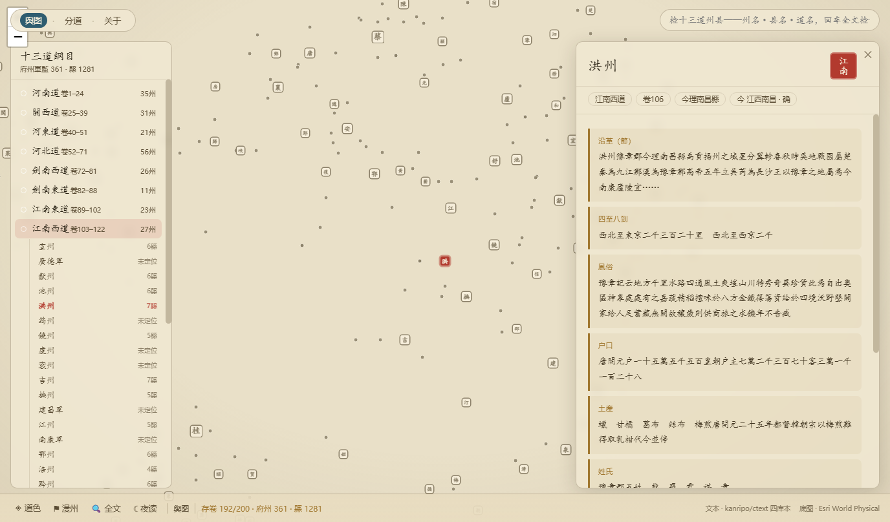
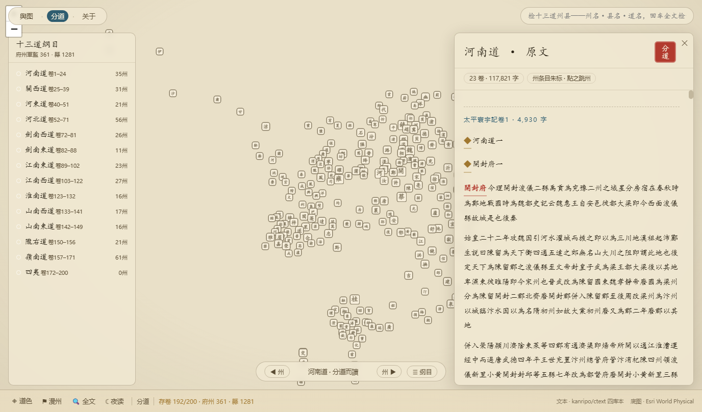

# 寰宇经纬 · 太平寰宇记

[](https://github.com/V-T-V/huanyu-jingwei/actions/workflows/ci.yml)

宋·乐史《太平寰宇记》二百卷数字人文站。纯静态前端 + Python 数据管线，四站会战（霞客/伽蓝/元和/寰宇）之一。

## 打开

```
python -m http.server 9700
# http://127.0.0.1:9700/index.html
```

**互查桥深链约定（两种场景同用相对兄弟路径）**：「↗方舆」深链 `../HHH/`、「↗元和」深链 `../YHJZ/`——
① 父目录同根服务：在 `D:\W_A_W` 起 `python -m http.server` 后 `/TPHY/`、`/HHH/`、`/YHJZ/` 同源互达；
② GitHub Pages 项目页：同账号下两站分别为 `user.github.io/TPHY/` 与 `user.github.io/YHJZ/`，
相对路径 `../YHJZ/` 同样解析到位。方舆/元和为兄弟站，本站只读其数据
（`tools/build_xref_fy.py` / `tools/build_xrev_yh.py`），**绝不写入**。

深链（选中状态自动写回 URL，刷新/分享保持）：
- `#mode=yutu&dao=jiangnanxi&zhou=洪州` —— 道 + 州详情（舆图模式）
- `#mode=fen&read=henan` —— 分道而读（懒加载该道全文）
- `#mode=duizhao` —— 明志对照（宋明府州互查桥，默认子页）
- `#mode=duizhao&xr=yh` —— 唐志对照（宋唐互查桥 · 宋视角子页）
- `#search=開封府` —— 直达一次检索

## 全景

| 舆图 · 州卡 | 分道而读 |
|---|---|
|  |  |

另有一座**三维形胜沙盘**（[3d.html](3d.html)，MapLibre + Esri 影像 + AWS 高程）：255 州治立于真山川
（夸张 1.35），六处形胜视角（關中望中原 / 劍門窺蜀 / 太行井陉……），点州开卡、可飞览。

- **舆图**：十三道（+四夷）州治印章点，道色开关；zoom≥6 显县微点（附郭取州治 +
  县条目方位里程三角化推算）；点州开详情卡（沿革/四至八到/风俗/土贡/县名录），点县见定位方法与县条目原文
- **分道而读**：左列十三道纲目 → 州名录 → 「分道而读」懒加载该道各卷全文（`data/text/*.js` 首屏不含），
  州条目朱标锚点、点击跳州、上一州/下一州巡读
- **检索**：顶栏检索州名·县名·道名（名录索引）；回车或点「🔍 全文」→ 按需加载全书
  818,819 字分片，Worker 纯数据扫描，命中卷片段预览，点击直达该道原文
- **夜读** ☾ 墨色主题（localStorage 记忆）；**漫州** ⚑ 随机一州游历
- **明志对照**（P2）：361 宋府州 ×《读史方舆纪要》明府/属州三重证据匹配（同名/升府/改名/明属州/存疑/无对应
  如实分栏），按道计数 + 样例 + **↗方舆**深链
- **唐志对照**（v0.2.1）：宋视角反向桥——元和站已判 227 唐州 ↔ 198 宋条，本站重组为每宋州 → 唐对应
  （同名 184 / 同治异名 6（升降并注）/ 异隶 8 / 无唐对应 163 如实分档），样例两书引文对读 + **↗元和**深链
  （`../YHJZ/#dao=<id>&zhou=<名>`）；与元和站「唐宋对照」页签互为表里（彼为唐视角正向桥）
- **导出** ⤓ 府州/县 CSV（BOM）· KML · GeoJSON · 宋明对照 CSV（「关于」面板，与 `tools/export_data.py` 同口径）；研究论文 PDF 见 docs/

## 数据源与覆盖（如实）

**侦察实录（2026-11-21）**：
- 维基文库 zh.wikisource.org —— 本网络环境不可达（TCP 直连失败），未采用、不冒称
- 国学导航 guoxue123.com —— 可达，史部目录无此书
- **主源：kanripo/KR2k0004（GitHub raw）** —— 文渊阁四库全书本《太平寰宇記》转录，
  UTF-8、结构完整、稳定可达；抓取脚本 `tools/fetch_text.py`（断点续抓、限速 ≥0.6s/页、UA 自报家门）

**存佚**：二百卷编号俱在；四库本原阙 8 卷（卷四、卷一一三至一一九），实得 **192 卷**，
正文 **818,819 字**（去空白）。缺就是缺，不以节选冒充全书。

**口径（凡数字必出自脚本）**：
- 府州军监条目 361（解析去重）；州治定位 255（确 195 / 推 60，agent 依地文学常识整编，
  一律标 `src:"derived"`，依据=州治今地）；未定位州 106 舆图不上点如实留白
- 属县 1,281；县上图 626 = 附郭 158 + 方位里程三角化 468（1 里≈0.55 km，方法近似）
- 计量详见 `docs/ANALYSIS.md` + `docs/stats.json`（`python tools/build_stats.py` 产出）

## 管线（可重入）

```
tools/fetch_text.py    # kanripo raw → data_raw/KR2k0004_NNN.txt（断点续抓: 已存即跳过）
tools/coverage.py      # 侦察结论固化 → data/coverage.json（可得性/阙卷/分道）
build_data.py          # 段落化+状态机解析 → data/site_data.js + data/intermediate/full.json
                       #   十三道→府州(今理/沿革/栏目)→县(清单+方位里程) + 坐标整编(tools/coords.py)+三角化
build_text.py          # 全文分道分片 → data/text/*.js（懒加载）+ manifest.json
tools/build_stats.py   # 文本计量 → docs/stats.json（ANALYSIS.md 数字之源）
tools/build_xref_fy.py # 宋明互查桥 → data/xref_fy.js（读 HHH site_data.js，只读不写）
tools/build_xrev_yh.py # 唐宋互查桥（宋视角） → data/xrev_yh.js（读 YHJZ xref_hy.js 判档，只读不写）
tools/export_data.py   # 古今对照导出 → docs/export/（CSV BOM/KML/GeoJSON，与前端按钮同口径）
tools/build_paper_pdf.py # 论文排印 → docs/寰宇经纬-数字人文.pdf（lint 哨兵联动 md↔PDF）
```

续抓演示：中断后重跑 `python tools/fetch_text.py` 自动跳过已存卷、只补缺失（本会话实抓中
卷 55 一次超时，重跑 2 秒补齐）。

## 验证

```
python -m http.server 9700 &
python run_tests.py   # lint 171 项 + 数据断言 + 4 断言页(70+ 断言, VT+CDP 双协议)
```

禁用清单（lint 强制）：`map.fire("click")` · `innerHTML.indexOf()` 验证 · `window._闭包量` ·
`git mv -q` · Worker 引 DOM · 核心模块硬引特性 DOM ID · `|| true` 兜底。
P2 哨兵：ANALYSIS.md 改动未重排 PDF 即红 · xref/export 与 stats 总账不符即红。

## 结构

```
index.html            # 入口（舆图/分道/对照/关于四模式）
3d.html               # 三维形胜（州点圆径随县数 + ▶飛覽六形胜连飞）
css/main.css          # 绢本设色体系
js/                   # config → map → rail → panels(含导出/对照) → reader → search → ftworker → fulltext → app（defer 链）
data/site_data.js     # 结构化数据（build_data.py 生成，勿手改）
data/xref_fy.js       # 宋明互查桥（build_xref_fy.py 生成，勿手改）
data/xrev_yh.js       # 唐宋互查桥 · 宋视角（build_xrev_yh.py 生成，勿手改）
data/text/*.js        # 十四分片全文（懒加载）
data/coverage.json    # 侦察与覆盖结论（coverage.py 生成）
tools/                # fetch/coverage/lint/build_stats/build_xref_fy/build_xrev_yh/export_data/build_paper_pdf + coords.py
tests/                # 4 断言页（VT dump-dom + CDP title 双协议）
vendor/               # Leaflet（自 HHH 复制，同版本）
docs/                 # ANALYSIS.md + stats.json + 寰宇经纬-数字人文.pdf + export/ + img/
```

## 坐标纪律

- 每个州坐标带 `now`（今地依据）与 `cf`（确/推）字段；全部 `src:"derived"`（agent 整编）
- 县点分 `fu`（附郭=州治）/ `tri`（三角化，带原文方位里程 `d`）两种，未定位县如实留白
- 未定位州 106 个多为羁縻州/边州（岭南陇右为多），俟考

学术引用：[CITATION.cff](CITATION.cff)（CFF 1.2.0 · dataset）——构建产物指纹账本另见 [SHA256SUMS](SHA256SUMS)，`python tools/build_sums.py` 重算、`run_tests.py` 对账。

## 版本

v0.2.1（2026-11-22）——唐志对照：宋×唐互查桥（宋视角）上线「对照」页签双子页
（`#mode=duizhao&xr=yh`），361 宋府州 → 唐对应 198（同名 184 · 同治异名 6 · 异隶 8）·
无唐对应 163（新置军监 28 · 新置/改并/阙卷 134 · 占位 1），样例两书对读 + ↗元和深链
（`../YHJZ/`，父目录同根服务 / 同账号 GitHub Pages 项目页两场景）；元和站 YHJZ 目录零写入；
lint 新增唐桥哨兵，ANALYSIS/论文 PDF 同步。

v0.2.0（2026-11-22）——P2 收官：论文 PDF（四库本删改与 8 卷原阙版本声明入文）、
古今对照导出（CSV BOM/KML/GeoJSON + 宋明对照，前端按钮与 tools 同口径）、
宋明府州互查桥（三重证据 361 州 → 对应 169/存疑 13/无 179，「对照」页签 + ↗方舆深链）、
3D 州点圆径随县数 + ▶飛覽连飞；lint 148 项全绿。

v0.1.0（2026-11-21）——首版：全书抓取解析、舆图、分道阅读、检索、计量。
